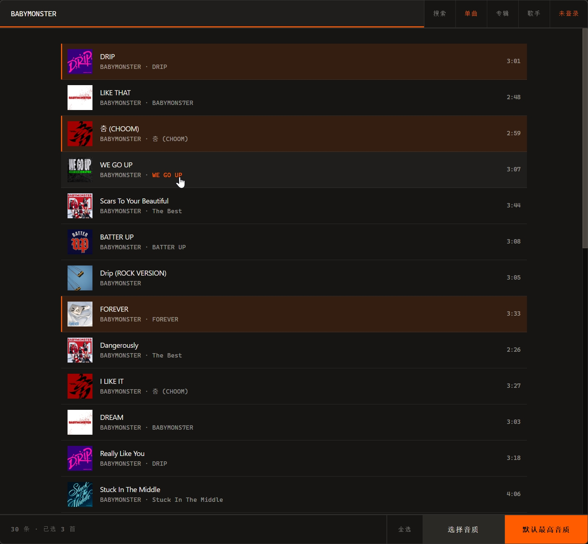

<div align="center">
<pre>╒═════════╗  ╒════╗   ╒════╗ ╒═════════╗
└┐  ╓───┐ ║  │    ╚╗  └┐  ╓╜ └┐  ╓───┐ ║
 │  ║   └─╜  │  ╟┐ ╚╗  │  ║   │  ║   └─╜
 │  ╚══╗     │  ║└┐ ╚╗ │  ║   │  ╚══╗   
 │  ╓──╜     │  ║ └┐ ╚╗│  ║   │  ╓──╜   
 │  ║        │  ║  └┐ ╚╡  ║   │  ║   ╒═╗
╒╛  ╚╗      ╒╛  ╚╗  └┐    ║  ╒╛  ╚═══╛ ║
└────╜      └────╜   └────╜  └─────────╜</pre>
</div>

> 本项目仅用于学习 Go 语言网络请求、AES 加解密、文件 I/O、元数据处理和并发编程



FNE 有两种模式。在线下载通过网易云 API 搜索并下载歌曲，本地转换把官方客户端下载的加密文件还原成标准音频格式

- **在线下载** — 扫码登录后搜索下载，音质按歌曲真实可用档位选择，网页操作，支持 Windows 和 Linux
- **本地转换** — 批量转换 NCM (网易) 和 QMC2 (QQ) 文件，元数据完整保留，仅 Windows

Windows / Linux 预编译版本见 [Releases](https://github.com/zyoung11/FNE/releases)

## 在线下载

无损和 Hi-Res 音质需要会员权益，不需要安装网易云客户端

1. 启动 FNE，选择「在线下载」
2. 用网易云 APP 扫码登录，cookie 保存后下次免登录。也可以跳过，未登录只能下载标准音质
3. 搜索歌名、专辑名或歌手名，也可以直接粘贴网易云链接或歌曲 ID
4. 点击歌曲行选中，支持多选和全选
5. 可以选择音质，也可以使用默认最高音质逻辑跳过选择
6. 确认保存位置，并开始下载

下载文件自带歌名、歌手、专辑和封面，文件名默认「歌手 - 歌曲名」，可通过配置文件 `nameFormat` 改为「歌曲名 - 歌手」

## 本地转换

> [!NOTE]
> 需要 VIP 会员，并在官方客户端中把歌曲下载到本地网易云的加密文件是`.ncm`，QQ 音乐是 `.mflac` / `.mgg` 等格式转换 QMC2 文件时 QQ 音乐客户端必须运行并处于登录状态

1. 启动 FNE 选择「本地转换」
2. 选择加密文件所在的文件夹
3. 选择输出文件夹
4. 等待转换完成

| 输入 | 输出 | 说明 |
|------|------|------|
| .ncm | FLAC / MP3 | 按原始格式输出，写入元数据和封面 |
| .mflac | FLAC | 加密无损 FLAC |
| .mgg | OGG | 加密 OGG，封面暂不支持 |

已转换过的歌曲自动跳过，文件创建时间保留

## 配置文件

Windows 在程序目录下读 `./config.json`，Linux 在 `~/.config/FNE/` 下读

```json
{
  "inputFolder": "C:/CloudMusic/VipSongsDownload",
  "outputFolder": "D:/Music/Converted",
  "recursive": false,
  "nameFormat": "artist - title",
  "apiConcurrent": 3,
  "apiDelayMin": 200,
  "apiDelayMax": 800
}
```

| 字段 | 类型 | 默认值 | 说明 |
|------|------|--------|------|
| `inputFolder` | string | - | 本地转换的输入文件夹 |
| `outputFolder` | string | - | 默认保存位置，下载模式预填 |
| `recursive` | bool | false | 本地转换是否递归扫描子文件夹 |
| `nameFormat` | string | `artist - title` | 下载文件命名，可选 `title - artist` |
| `apiConcurrent` | int | 3 | QMC2 解密的 API 并发限制 |
| `apiDelayMin` | int | 200 | QMC2 解密的 API 最小延迟(ms) |
| `apiDelayMax` | int | 800 | QMC2 解密的 API 最大延迟(ms) |

所有字段均可省略

## 本地编译

```bash
git clone https://github.com/zyoung11/FNE.git
cd FNE
go build -ldflags="-s -w" .
```

## License

MIT
